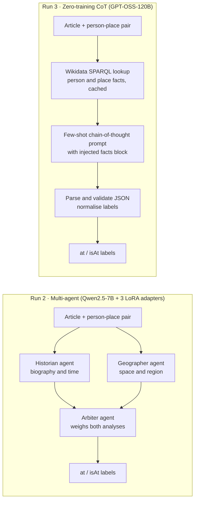

# HIPE-2026 — Team Hansel & Gretel

**Team Hansel & Gretel** — [HIPE-2026 Shared Task](https://hipe-eval.github.io/HIPE-2026/) on Person–Place Relation Extraction from Historical Newspapers.

**Authors:**
- Pradyuman Singh Shekhawat — pradyuman_ss@cs.iitr.ac.in
- Rohan Gupta — rohan_g@cs.iitr.ac.in

**Affiliation:** Department of Computer Science and Engineering, Indian Institute of Technology Roorkee

📄 **Paper:** [CLEF 2026 working notes (PDF, 14 pp)](notebook-paper/hipe2026_ceurart.pdf) · **System description:** [PDF](submission/system_description.pdf) · **Official results:** [HIPE-2026 results](https://hipe-eval.github.io/HIPE-2026/results)

---

## At a glance

- **11th of 46** submissions on the generalisation profile (Run 2, multi-agent Qwen2.5-7B), **13th of 46** on accuracy (Run 3, GPT-OSS-120B + Wikidata).
- **9 measured strategies**: frozen encoders → LoRA multi-task → generative SFT → a three-agent specialist system → zero-training chain-of-thought with live knowledge-graph grounding. Global macro recall on our evaluation split went from 0.42 (random baseline) to 0.73 ([cross-strategy analysis](ourWork/strategy7/ANALYSIS.md)).
- **Agent design, not just a bigger model.** Run 2 splits the reasoning across LoRA-tuned specialists and an arbiter; Run 3 grounds a 120B model in Wikidata facts fetched at inference time, with a cache and strict JSON validation of every answer.
- **Built-in evaluation.** Strategies are scored against the official macro-recall metric with their own analyses, plus an LLM-as-judge script (`ourWork/strategy8/llmaj.py`, `ourWork/strategy9/llmaj.py`).

### How the two strongest systems work



---

## Task Overview

The HIPE-2026 shared task requires systems to extract and classify person–place relations from multilingual historical newspaper articles (German, French, English). For each person–location pair, systems must predict:

- **`at`** — whether the person was ever associated with the location (3-class: TRUE, PROBABLE, FALSE)
- **`isAt`** — whether the person was at the location around the time of publication (binary: TRUE, FALSE)

Evaluation uses **Macro Recall**, equally weighting all label classes.

For full task details, official guidelines, dataset, evaluation scripts, and results, see the **[HIPE-2026 website](https://hipe-eval.github.io/HIPE-2026/)**.

| Resource | Link |
|----------|------|
| Task description & guidelines | [hipe-eval.github.io/HIPE-2026](https://hipe-eval.github.io/HIPE-2026/) |
| Official dataset | [HIPE-2026-data](https://github.com/hipe-eval/HIPE-2026-data) |
| Organiser-provided LLM baseline | [HIPE-2026-llm-baseline](https://github.com/hipe-eval/HIPE-2026-llm-baseline) |
| Evaluation scripts & all submissions | [hipe-2026-eval](https://github.com/hipe-eval/hipe-2026-eval) |
| Official results | [Results page](https://hipe-eval.github.io/HIPE-2026/results) |

---

## Repository Structure

```
.
├── ourWork/                 # Our strategies & experiments (S1–S9)
├── submission/              # Final submitted prediction files & system description
├── notebook-paper/          # Working notes paper (LaTeX + PDF)
│   └── CLEF2026-template/   # CEUR-WS LaTeX template
├── eda_results.txt          # Exploratory data analysis on the training set
├── LICENSE                  # MIT License
└── README.md
```

---

### `ourWork/`

Contains all the strategies we developed and deployed during the shared task. Each strategy is in its own subdirectory:

| Strategy | Description |
|----------|-------------|
| `planning/` | Initial planning and approach design |
| `strategy1/` – `strategy9/` | Iterative experimental strategies |

Our final submitted runs were based on:
- **Run 1 (Strategy 5):** Fine-tuned Qwen2.5-3B-Instruct with LoRA (~3B params)
- **Run 2 (Strategy 7):** Multi-agent fine-tuned Qwen2.5-7B-Instruct with 3 LoRA adapters (~7B params)
- **Run 3 (Strategy 9):** Zero-training few-shot GPT-OSS 120B with Wikidata knowledge injection (~120B params)

> **Dependencies:** Each strategy directory contains its own `requirements.txt` where applicable. Install per-strategy with `pip install -r ourWork/strategyN/requirements.txt`.

---

### `submission/`

Contains our final submitted prediction files and the system description paper.

- **12 prediction files** (4 test sets × 3 runs) in JSONL format, validated against the official schema.
- `system_description.pdf` — Short system description submitted to the organisers.

Test sets covered: `impresso-test-de`, `impresso-test-en`, `impresso-test-fr`, `surprise-test-fr`.

---

### `notebook-paper/`

Working notes paper for CLEF 2026, describing our system, experiments, and results. See [`notebook-paper/README.md`](notebook-paper/README.md) for compilation instructions.

- `hipe2026_ceurart.tex` — Our paper source (LaTeX).
- `hipe2026_ceurart.pdf` — Compiled PDF (14 pages).
- `ceurart.cls` — CEUR-WS document class (required to compile).
- `references.bib` — Bibliography.
- `guidelines.txt` — Paper writing guidelines from the organisers.

#### `notebook-paper/CLEF2026-template/`

The official **CEUR-WS one-column LaTeX template** (`ceurart`) that must be used for formatting the working notes paper. See its `README.md` for usage instructions.

---

## Results

**Our team is Team 9 (Hansel & Gretel).** Full results are available on the [official results page](https://hipe-eval.github.io/HIPE-2026/results).

| Run | Strategy | Model | Accuracy Rank | Generalization Rank |
|-----|----------|-------|:-------------:|:-------------------:|
| Run 1 | S5 — Generative SFT | Qwen2.5-3B-Instruct | 23/46 | 15/46 |
| Run 2 | S7 — Multi-Agent | Qwen2.5-7B-Instruct (3 agents) | 19/46 | **11/46** |
| **Run 3** | **S9 — CoT + Wikidata** | **GPT-OSS 120B via IBM RITS** | **13/46** | 14/46 |

Best official test score: **0.6221** (Run 3, accuracy profile). Best generalization score: **0.6349** (Run 2, surprise test set).

---

## Quick Start

```bash
# Clone the repository
git clone https://github.com/ikshv4ku/HIPE-2026-Team-Hansel-Gretel.git
cd HIPE-2026-Team-Hansel-Gretel

# Look at our strategies
ls ourWork/

# Read the paper
open notebook-paper/hipe2026_ceurart.pdf
```

---

## Acknowledgements

This work was carried out as part of the [HIPE-2026 Shared Task](https://hipe-eval.github.io/HIPE-2026/) at [CLEF 2026](https://clef2026.clef-initiative.eu/), organized by the Digital Humanities Lab (EPFL) and the Institute of Computational Linguistics (University of Zürich).

---

## License

This project is licensed under the [MIT License](LICENSE).
